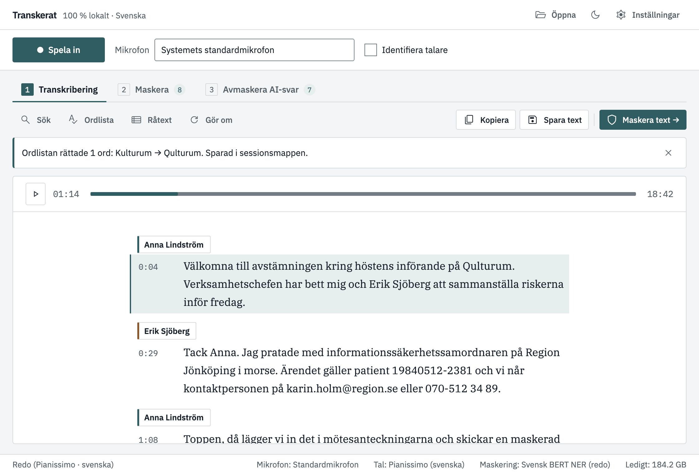
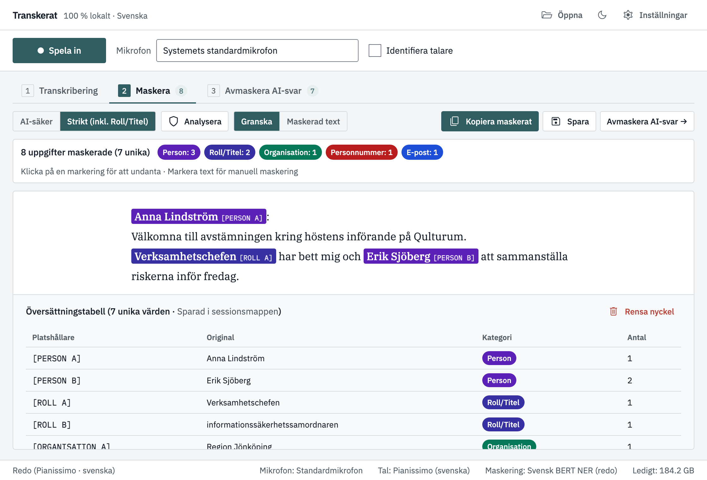
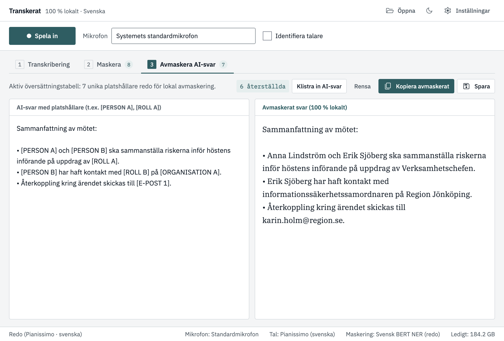

# Transkerat

**100 % lokalt · 100 % svenska**

**Transkerat** är en skrivbordsapp för Windows och macOS som kombinerar lokal svensk transkribering (**Pianissimo**) med lokal integritetsmaskering och avmaskering (**Maskera Lager 1 & 2**).

All taligenkänning, namn- och rollmaskering samt återställning av AI-svar sker helt lokalt på din egen dator — inget ljud och inga personuppgifter skickas någonsin vidare.

> **Nedladdning:** Hämta färdigbyggd version för Windows (portabel `.exe` eller installerare) och macOS (Apple Silicon `.dmg`) under **[Releases](https://github.com/mrswedish/transkerat/releases/latest)**.

---

## Så fungerar det — tre steg från möte till färdig sammanfattning

### 1. Transkribering (Pianissimo · svenska)
Spela in möten direkt i appen (mikrofon + systemljud på Windows) eller öppna en ljud- eller videofil (MP3, M4A, WAV, MP4 m.fl.).

- **Endast svenska Pianissimo** — körs snabbt på vanlig processor utan krav på grafikkort.
- **Talaridentifiering (valfritt)** — skiljer på vem som säger vad, med möjlighet att ge talarna egna namn.
- **Personliga ordlistor** — rättar automatiskt facktermer och namn som ofta hörs fel (t.ex. `Kulturum => Qulturum`).
- **Synkad ljudspelare** — klicka på valfri tidsstämpel för att lyssna och korrigera texten direkt.



---

### 2. Maskera (Lager 1 + Lager 2)
Klicka på **Maskera text →** för att pseudonymisera transkriptet lokalt innan du klistrar in det i en extern AI-tjänst (t.ex. ChatGPT, Copilot eller Claude).

- **Två färdiga profiler:**
  - **AI-säker** — maskerar personnummer/samordningsnummer, e-post, telefonnummer, org.nummer, konto/giro, kortnummer, hemligheter/nycklar samt personer, organisationer, platser och övrigt.
  - **Strikt (inkl. Roll/Titel)** — maskerar allt i *AI-säker* plus svenska yrkesroller och befattningar (`[ROLL A]`, t.ex. *verksamhetschefen*, *informationssäkerhetssamordnaren*), IP-adresser, tider och händelser.
- **Full kontroll i granskningsvyn:**
  - Klicka på valfri markering för att undanta eller återaktivera den.
  - Markera valfri text för att lägga till en manuell maskering.
  - Översättningstabellen visar exakt hur varje `[PLATSHÅLLARE]` mappas till originalet.
- **Kopiera maskerat** med ett klick för att klistra in i din AI-tjänst.



---

### 3. Avmaskera AI-svar (100 % lokalt)
När din AI-tjänst har sammanfattat mötet eller skrivit ett utkast klistrar du in svaret (som innehåller `[PERSON A]`, `[ROLL A]`, `[ORGANISATION A]` osv.) i steg 3.

- Alla platshållare återställs **omedelbart och lokalt** via sessionens översättningstabell.
- Kopiera det färdiga, avmaskerade svaret eller spara det som textfil.



---

## Integritet & sessionslagring

- **100 % lokal bearbetning:** Efter att de lokala modellerna hämtats en första gång fungerar appen helt offline:
  - **Pianissimo** (~660 MB) — svensk taligenkänning (ONNX, CPU)
  - **KBLab Svensk BERT NER** (~127 MB) — svensk namngiven entitetsigenkänning (INT8 ONNX)
  - **Talaridentifiering** (~33 MB, valfri) — pyannote community-1 i ren Rust
- **Krasch- och omstartssäkert arbetsflöde:** Som standard sparas transkribering (`transkribering.json` / `.txt`), maskerad text (`maskerad.txt`) och maskeringsnyckel (`maskering.json`) lokalt i samma sessionsmapp som inspelningen.
  - Du kan stänga appen och avmaskera ett AI-svar senare via **Öppna → Senaste inspelningar**.
  - Importerade ljudfiler får en egen lokal sessionsmapp i `Transkerat-Inspelningar` — appen skriver aldrig nycklar bredvid externa filer i t.ex. *Hämtade filer* eller nätverksmappar.
  - **Allt raderas tillsammans:** När du raderar en inspelning försvinner ljudfil, transkript och nyckel samtidigt. Du kan även klicka **Rensa nyckel** direkt i översättningstabellen, eller slå av lokal sparning under *Inställningar → Inspelningar* för att hålla allt enbart i arbetsminnet.

---

## Utveckling & bygge

### Förutsättningar
- [Node.js](https://nodejs.org/) (v20+)
- [Rust](https://www.rust-lang.org/) (stable)

### Kör lokalt
```bash
npm install
npm run tauri dev
```

### Kör tester
```bash
cargo test --manifest-path src-tauri/Cargo.toml
```

### Bygg produktionspaket
```bash
npx tauri build
```

---

## Byggt på
Transkerat förenar komponenter och modeller från:
- **Transkribera** (inspelning, Pianissimo-motor, talaridentifiering via `speakrs`, ordlistor)
- **Maskera** (Lager 1 svensk regex- & befattningsmotor, Lager 2 KBLab Svensk BERT NER, översättningstabell & lokal avmaskering)
- **Klang AI / Pianissimo** (`KlangAI/pianissimo-sv-onnx`) & **KBLab / Kungliga biblioteket** (`bert-base-swedish-cased-ner`)
